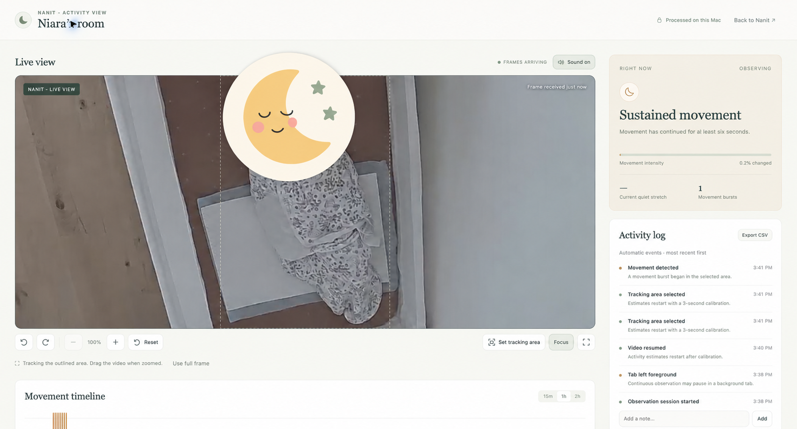

# Ripples

Small movements, made visible.

**Developed and tested with the Nanit baby monitor’s live web feed.** You can use a coding agent to adapt Ripples for other baby monitors with a browser-accessible live feed; [AGENTS.md](AGENTS.md) covers setup and code structure. Other monitors require integration changes and testing.

An independent local activity dashboard for Nanit, unaffiliated with Nanit. This Chrome extension runs on `https://my.nanit.com/`. It uses the video already playing in your signed-in Nanit tab. No Nanit credentials, separate connection, subscription, API, external service, or build step is required.

**Everything Ripples adds runs locally on your device.** Motion analysis happens in your browser, and activity history, notes, and viewing preferences stay in your current Chrome profile. Ripples has no backend, cloud analysis, analytics, or telemetry, and it does not upload frames, audio, movement scores, or notes. No AI service is used for motion detection.

Ripples reuses the video already playing in Nanit's web app. Nanit still delivers that stream through its own service, so live viewing requires Nanit's connection; the local-only claim applies to Ripples' processing and storage.



*Privacy-edited capture of the live v0.1.2 dashboard on 2026-10-19. The running installation still displays its earlier “Nanit Activity View” branding. The moon placeholder was added to this documentation image and is not a feature of the live viewer.*

## Features

- **Live activity:** little movement, movement detected, sustained movement, calibration, and explicit unavailable states. A quiet stretch is observed stillness, not confirmed sleep.
- **Movement timeline:** 15-minute, 1-hour, and 2-hour windows. Hover to inspect a sample. Blank intervals represent missing observations; observations are never interpolated through gaps.
- **Automatic log:** session starts, movement starts and settling, settings changes, pauses, and video interruptions. Add your own notes and export CSV. It does not claim to recognize caregivers, pickups, or put-downs.
- **Viewing controls:** rotate in 90° steps, zoom 1–4×, drag to pan, select a tracking region, focus on that region, reset, and fullscreen (with an expanded in-tab fallback). Escape or **Exit expanded view** returns to the dashboard. Focus, pan, rotation, zoom, the timeline range, expanded/minimized viewing, sensitivity, and the tracking pause state persist across refreshes. The focus and tracking area map correctly through rotation and zoom.
- **Live sound:** the Sound button unmutes or mutes the original Nanit player; it creates no second stream and does not capture or record audio. It reflects the player's current mute/play state and reports playback failures. The sound choice is remembered; **Enable sound** appears if the browser requires a click to restore it.

## Install locally

**Ask your agent to follow this section to install Ripples locally.**

Loading the extension grants this code access to the Nanit page and its private video. Review the source first. Its only declared API permission is `storage`, and its content script only matches `https://my.nanit.com/*`.

1. Open Chrome’s Extensions page (`chrome://extensions`).
2. Enable **Developer mode**.
3. Choose **Load unpacked** and select Ripples’ **extension** folder.
4. Reload the Nanit tab once. The activity view will appear over the original page.
5. Choose **Set tracking area** and drag a rectangle around your baby. The rectangle stays in camera coordinates when you rotate or zoom. Calibration takes about three seconds. **Use full frame** works without drawing but includes room movement.

**Back to Nanit** restores the original page while observing continues when frames arrive. Use the floating button to reopen the activity view. To remove the view, turn the extension off in Chrome and reload Nanit; no Nanit account settings are changed.

For an update, use **Reload** on this existing extension in Chrome's Extensions page, then refresh Nanit. Keep the existing extension installed to retain its local data.

## What happens on refresh

The extension uses `chrome.storage.local` in the current Chrome profile. It keeps at most 250 event/note entries from the past 24 hours and 2 hours of timestamped movement scores. Preferences have a dedicated key, written immediately when a setting changes: tracking region, camera dimensions, rotation, zoom, Focus, pan, timeline range, sensitivity, tracking pause, minimized/expanded viewing, and sound choice. Existing history and older preferences migrate automatically. Raw video and audio are not stored by the extension.

Refreshing reloads that history and those settings, starts a new observation session, and recalibrates for about three seconds when tracking is enabled. The current quiet timer and session burst count reset. Paused tracking stays paused; a minimized dashboard stays minimized. Pan is saved as a fraction of the viewport so it remains meaningful after a window resize. A different video source or changed camera dimensions clear the tracking region and its dependent framing. No observations are made while the Nanit tab is closed or reloading. History writes are delayed by about 1.5 seconds, so the newest activity samples or events can be lost during an immediate refresh. Preference writes do not use that delay.

The saved sound choice is applied when the video becomes ready. Browser [autoplay rules](https://developer.chrome.com/blog/autoplay/) can require a click to restore sound; the UI shows **Enable sound** when that happens and keeps the video available. The preference remains saved. Expanded viewing restores inside the tab; entering native browser fullscreen requires a click.

## Local preview and tests

Requires Node.js 20 or newer. There are no dependencies to install.

```sh
npm test
npm run check
npm start
```

Open `http://127.0.0.1:4317`. The preview runs the same core and interface against a generated canvas video, clearly labeled **Simulated feed**. The test controls can generate motion, change lighting, interrupt frames, and replace the video. It contains no real nursery video or real activity data. The preview server binds only to localhost.

## How motion detection works

Ripples measures changes between video frames inside the tracking area you select. It uses a small image-difference algorithm in `extension/core.js`; it does not send the video to a model or recognize people or actions.

1. **Sample the selected area.** Up to five times per second, the browser crops that area from the existing video, resizes it to 160×90 pixels, and converts it to grayscale. This work happens in memory.
2. **Correct for overall brightness changes.** Compare each pixel with the previous sample and subtract the median brightness shift. This reduces false movement from uniform exposure changes, although shadows and uneven lighting can still affect the result.
3. **Count changed pixels.** A pixel counts as changed when its corrected brightness difference exceeds the sensitivity threshold. The raw score is `changed pixels ÷ 14,400 × 100`. The displayed score is smoothed by combining 50% of the previous score with 50% of the new score. It is a percentage of sampled pixels that changed, not a confidence score or a physical movement measurement.
4. **Apply timing rules.** Tracking begins with about three seconds of calibration. A movement burst starts when the smoothed score stays at or above the start threshold for at least 0.6 seconds. A burst that continues for six seconds becomes **Sustained movement**. The burst settles after the score stays at or below the lower stop threshold for 2.5 seconds. These separate thresholds and durations reduce flickering states and brief noise spikes.
5. **Build the local history.** Ripples records movement starts and settling in the log, and keeps at most one timeline sample per second. Only scores, timestamps, event text, and preferences are saved; the sampled images are not retained as history.

| Sensitivity | Pixel brightness difference* | Movement starts at | Settles at or below |
| --- | --- | --- | --- |
| Low | More than 18 | 3.5% | 1.2% |
| Normal (default) | More than 12 | 2.0% | 0.65% |
| High | More than 8 | 1.0% | 0.35% |

*Brightness is measured on a 0–255 grayscale after the overall brightness correction. Start and stop thresholds use the smoothed score and timing rules above.*

Very dark, washed-out, or low-detail images become **unclear**, rather than quiet. A sampling gap longer than 1.8 seconds resets tracking; five seconds without a new frame makes the feed unavailable. Pauses, visibility changes, region changes, and source changes also reset the relevant estimates. Missing intervals stay gaps in the timeline. A replacement source or changed camera dimensions clears the tracking area and dependent framing so the previous selection is not silently applied to a different view.

Movement estimates describe changed pixels, not their cause. Rocking, shadows, a caregiver entering the area, or a blanket moving can all contribute. Stillness does not confirm sleep or breathing, and new frames do not prove the camera scene is current: an upstream source could repeat frozen images.

## Privacy and limits

- All Ripples image processing happens in the browser. Frames exist in memory only; the extension does not save or upload screenshots, audio, clips, or video. The README screenshot was captured separately and edited for documentation.
- Extension-local storage holds preferences, up to 2 hours of movement samples, and at most 250 log entries from the past 24 hours. Expired records are pruned while running and on next startup. Chrome can clear this data by removing the extension. The preview has separate browser-local storage.
- Tracking requires the Nanit tab to stay open and playing. Browsers can throttle background tabs or sleeping computers. Keep the tab visible for continuous observation; gaps are displayed as unknown.
- A covered, rocking, shadowed, or moving scene can produce misleading motion readings. The app measures changed pixels, not why they changed.
- Protected or cross-origin-tainted video may prevent analysis. The app reports that state and leaves the original Nanit page available; it does not bypass video protections.
- No breathing, heart rate, oxygen, medical, or safety status is inferred. This is an activity and viewing tool.
- The interface, sound control, movement estimates, and persistence have been checked against a generated feed and one live Nanit setup. These checks do not establish clinical accuracy or reliable continuous background monitoring. Compatibility can change when Nanit changes its web player.

Unedited nursery captures and activity exports are excluded from this repository. Only the privacy-edited documentation screenshot is included. The original Nanit page still connects to Nanit’s services as usual.

The extension uses Chrome’s documented [content scripts](https://developer.chrome.com/docs/extensions/develop/concepts/content-scripts) and [unpacked installation workflow](https://developer.chrome.com/docs/extensions/get-started/tutorial/hello-world).
